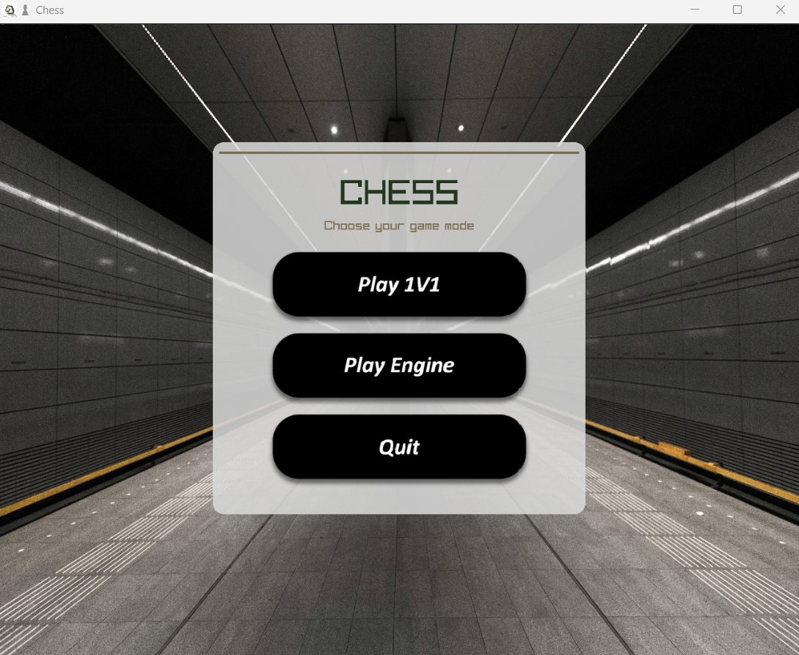
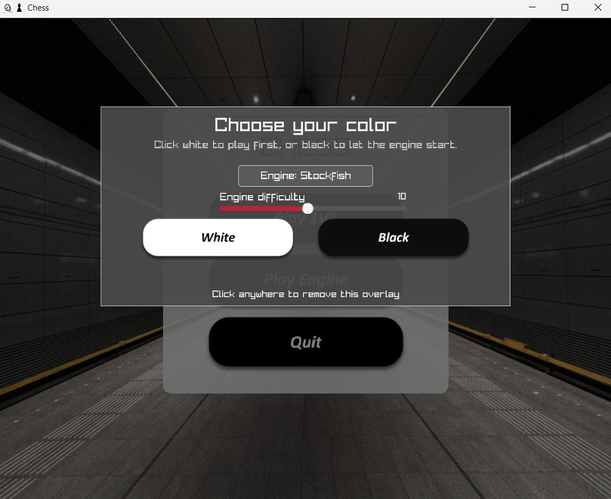
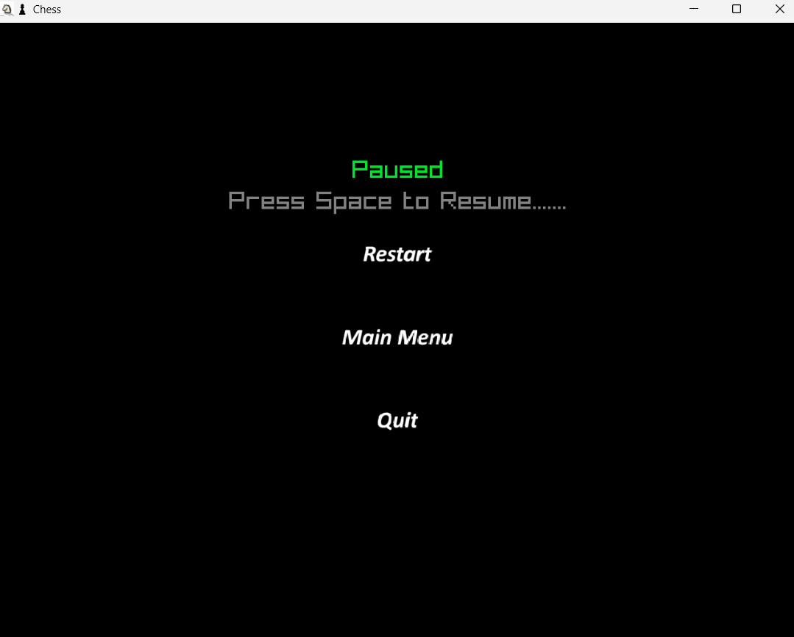
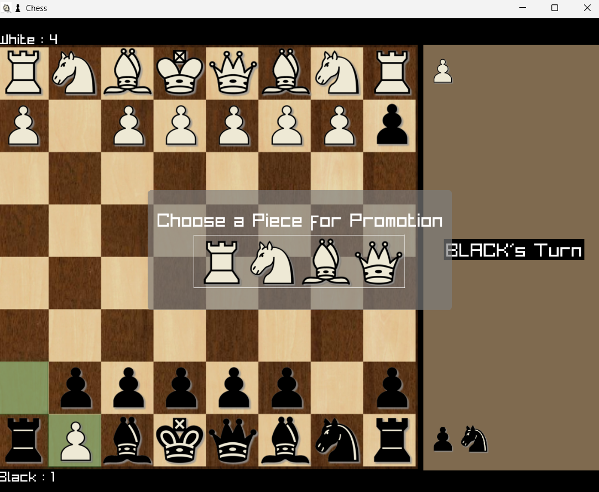
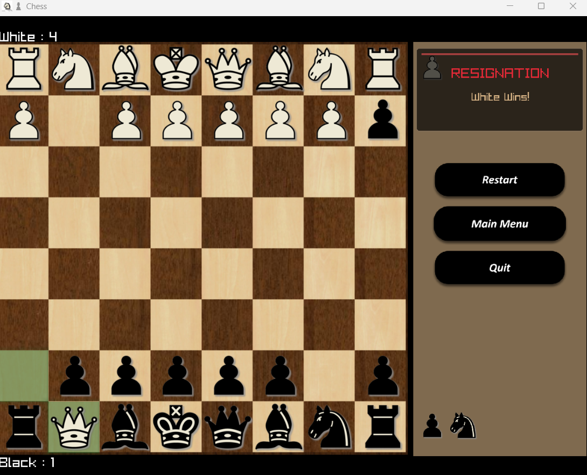
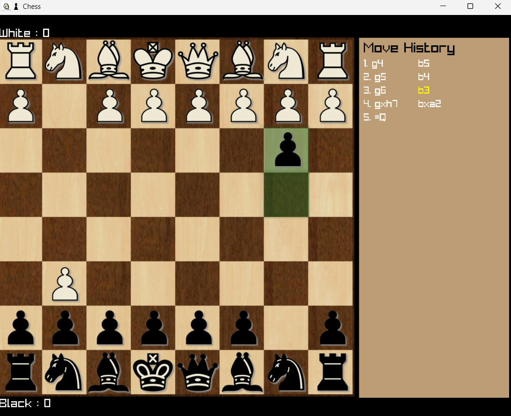

# Project1 - Chess

A desktop chess game built with C++ and raylib.

This project is an in-progress chess application with:

- Local player-vs-player mode
- Local player-vs-engine mode (Integrated with Stockfish)
- Move history and undo functionality
- Menu system, difficulty slider and game state handling
- UI assets and buttons for navigation

## How to Play & Controls

### 1. Main Menu

Three buttons are shown on the main menu:



| Button | Action |
|--------|--------|
| **[Start]** | Start a local 1v1 game (Player vs Player) |
| **[Engine]** | Start a game against the computer (Player vs Engine) |
| **[Exit]** | Close the game |

### 2. Engine Mode Setup

After clicking **[Engine]**, a setup screen appears:



- **Engine Toggle** - Click to switch between Stockfish and Neural Bot
- **Difficulty** - Drag the slider (1-20) to set engine strength
- **[White Piece]** - Play as White (you move first)
- **[Black Piece]** - Play as Black (engine moves first)

Click anywhere outside the panel to cancel and return to the menu.

### In-Game Controls

| Input | Action |
|-------|--------|
| **Mouse (Left-Click + Drag)** | Pick up a piece and drag it to a square to move |
| **Mouse (Click-to-Move)** | Left-click a piece to select it, then left-click the destination square |
| **SPACE** | Pause / Resume the game |
| **M** | Toggle valid move highlights on/off |
| **H** | Toggle the move history panel on/off in the side bar |
| **LEFT / RIGHT Arrow** | Step backward / forward through move history |
| **Resign Button** | Resign the current game (bottom-right during play) |

### 3. Pause Menu

Press **SPACE** during a game to pause. While paused you can:



- **[Restart]** - Reset the board and start a new game
- **[Main Menu]** - Return to the main menu
- **[Exit]** - Close the game

### 4. Pawn Promotion

When a pawn reaches the last rank, a promotion panel appears. Click one of the four pieces: **Queen / Rook / Bishop / Knight**



### 5. Game Over

The game ends by Checkmate, Stalemate, Insufficient Material, or Resignation:



- **Checkmate** - One side wins. The winner is displayed.
- **Stalemate** - Draw. Neither side has a legal move.
- **Insufficient Material** - Draw. Not enough pieces to checkmate.
- **Resignation** - The other side wins.

After the game ends, three buttons appear: **[Restart]**, **[Main Menu]**, **[Exit]**

### 6. Move Review

Use **LEFT/RIGHT arrow keys** to browse through the move history. The board updates to show each past position. Press any mouse button or make a move to exit review mode.



### 7. Board Highlights

| Highlight | Meaning |
|-----------|---------|
| Green squares | Last move played (from and to squares) |
| Red glow | King is in check |
| Purple dots | Valid move indicators (toggle with M) |

### 8. Side Panel

The right-side panel displays:
- Whose turn it is
- Captured pieces for both sides
- Score estimate
- Move history (toggle with H)

## Tech Stack

- C++14
- raylib 5.x
- GNU Make
- MinGW-w64 (Windows) / GCC or Clang (Linux/macOS)

## Prerequisites

### Windows

The Makefile defaults expect these paths:

- raylib source: `C:/raylib/raylib`
- compiler tools: `C:/raylib/w64devkit/bin`

Install:

1. raylib (compatible with 5.x)
2. MinGW-w64 / w64devkit (with `g++` and `mingw32-make`)
3. Git
4. Stockfish chess engine

### Linux (Debian/Ubuntu)

```bash
# Install raylib (development files)
sudo apt install libraylib-dev

# Or build from source:
# git clone https://github.com/raysan5/raylib.git
# cd raylib/src
# make PLATFORM=PLATFORM_DESKTOP
# sudo make install

# Install build tools
sudo apt install g++ make

# Install Stockfish
sudo apt install stockfish
```

### macOS (Homebrew)

```bash
# Install raylib
brew install raylib

# Install build tools (Xcode Command Line Tools provides clang++ and make)
xcode-select --install

# Install Stockfish
brew install stockfish
```

## Downloading Stockfish

To play against the computer, you need the Stockfish engine executable in the project root directory.

### Windows

1. Go to the [Stockfish download page](https://stockfishchess.org/download/).
2. Download the appropriate version for Windows.
3. Extract the ZIP, rename the executable to `stockfish.exe`.
4. Place `stockfish.exe` in the project root (alongside `Makefile`).

> **Note:** The `stockfish.exe` binary is already ignored by `.gitignore` (`*.exe`).

### Linux

If installed via `apt`, the `stockfish` binary is in your `PATH`. The game will find it automatically. If you want a specific build, place a `stockfish` executable (no extension) in the project root.

### macOS

If installed via `brew`, the `stockfish` binary is in your `PATH`. The game finds it via `exec` lookup. To use a specific build, place `stockfish` in the project root.

## Setup From Scratch (Windows)

### 1) Clone the repository from GitHub

```powershell
git clone https://github.com/Anam-Neupane/Project1-Chess.git
cd Project1-Chess
```

### 2) Install raylib and w64devkit

This project expects the following paths:

- `C:/raylib/raylib`
- `C:/raylib/w64devkit/bin`

Steps:

1. Download raylib source and place it at `C:/raylib/raylib`.
2. Download `w64devkit` and place it at `C:/raylib/w64devkit`.
3. Verify the tools:

```powershell
C:/raylib/w64devkit/bin/g++.exe --version
C:/raylib/w64devkit/bin/mingw32-make.exe --version
```

### 3) Open the project in VS Code

```powershell
code .
```

Install these extensions if they are missing:

- C/C++ (`ms-vscode.cpptools`)
- Makefile Tools (`ms-vscode.makefile-tools`)

## Build and Run From Terminal

### Windows

Open PowerShell or Command Prompt in the project root, then run:

```powershell
C:/raylib/w64devkit/bin/mingw32-make.exe RAYLIB_PATH=C:/raylib/raylib PROJECT_NAME=game BUILD_MODE=DEBUG
```

Run the game:

```powershell
.\game.exe
```

Build a release binary:

```powershell
C:/raylib/w64devkit/bin/mingw32-make.exe RAYLIB_PATH=C:/raylib/raylib PROJECT_NAME=game BUILD_MODE=RELEASE
```

Clean build artifacts:

```powershell
C:/raylib/w64devkit/bin/mingw32-make.exe clean
```

### Linux / macOS

Open a terminal in the project root, then run:

```bash
make PROJECT_NAME=game BUILD_MODE=DEBUG
```

Run the game:

```bash
./game
```

Build a release binary:

```bash
make PROJECT_NAME=game BUILD_MODE=RELEASE
```

Clean build artifacts:

```bash
make clean
```

> **Note:** On Linux/macOS, raylib should be installed system-wide or findable via standard paths. If raylib is installed in a custom location, set `RAYLIB_PATH` and optionally `DESTDIR` (see the Makefile for details).

## Run and Debug in VS Code (F5)

1. Open `src/main.cpp` in the editor.
2. Press `F5`.
3. Select the `Debug` configuration.
4. VS Code runs the pre-launch task (`build debug`) and starts the debugger.

Notes:

- In this workspace, the output name used by F5 depends on the active file name.
- If `src/main.cpp` is active, the generated executable is `main.exe`.
- For a fixed output name (`game.exe`), use the terminal build command from this README.

## Platform Notes

- **Windows**: The Makefile defaults expect raylib at `C:/raylib/raylib` and w64devkit at `C:/raylib/w64devkit/bin`. Override `RAYLIB_PATH` and `COMPILER_PATH` if your setup differs.
- **Linux/macOS**: raylib must be installed system-wide (via apt, brew, or from source with `make install`). The Makefile detects the platform automatically and links the correct libraries. Override `RAYLIB_PATH` if raylib is at a non-standard location.
- Stockfish is expected as `stockfish` (Linux/macOS) or `stockfish.exe` (Windows) in `PATH` or the project root.

## Project Structure

```text
.
|-- Makefile
|-- README.md
|-- Documentation/
|-- engines/
|   `-- neural-bot/
|       `-- _internal/
|           |-- checkpoints/        (PyTorch model weights)
|           |-- torch/
|           |-- numpy/
|           `-- ... (bundled Python runtime)
|-- lib/
|   |-- httplib.h                   (cpp-httplib header-only HTTP library)
|   |-- json.hpp                    (nlohmann/json header-only JSON library)
|   |-- libgcc_s_dw2-1.dll
|   `-- libstdc++-6.dll
|-- resource/
|   |-- app.rc / app.res            (Windows resource files)
|   |-- background.jpg
|   |-- black.png / white.png
|   |-- board0.png / board1.png
|   |-- Engine_Menu.png
|   |-- figure1.png
|   |-- Gameover.png
|   |-- howto.png
|   |-- Icon.ico / Icon-01.ico
|   |-- mainmenu.png
|   |-- Menu.png
|   |-- Paused.png
|   |-- Picture1.png / Picture2.png / Picture3.png
|   |-- Promotion_menu.png
|   |-- resign.png
|   |-- restart.png
|   `-- Review.png
`-- src/
    |-- main.cpp
    |-- core/
    |   |-- Board.cpp / Board.hpp
    |   |-- Constants.hpp
    |   |-- GameState.cpp / GameState.hpp
    |   |-- MoveHistory.cpp / MoveHistory.hpp
    |   |-- Piece.hpp
    |   `-- moves/
    |       |-- cpp/
    |       |   |-- MoveGeneration.cpp
    |       |   |-- MoveSimulation.cpp
    |       |   |-- MoveValidator.cpp
    |       |   `-- PieceMovement.cpp
    |       `-- hpp/
    |           |-- MoveGeneration.hpp
    |           |-- MoveSimulation.hpp
    |           |-- MoveUtils.hpp
    |           |-- MoveValidator.hpp
    |           `-- PieceMovement.hpp
    |-- engine/
    |   |-- ChessEngine.hpp
    |   |-- EngineMove.hpp
    |   |-- NeuralEngine.cpp / NeuralEngine.hpp
    |   |-- StockfishEngine.cpp / StockfishEngine.hpp
    `-- ui/
        |-- button.cpp / button.hpp
        |-- platform_win32.cpp / platform_win32.hpp
        `-- slider.hpp
```

## Common Issues

- Undefined reference/linker errors: do not override `OBJS` with only top-level files (for example `OBJS=src/*.cpp`) because this excludes required source files in subfolders.
- `raylib.h` not found: verify the `RAYLIB_PATH` value and folder contents.
- Game cannot load textures: run the executable from the project root so relative paths like `resource/...` resolve correctly.

## Current Status

This is my first project and it will be horrible I know.
I Just want to Enjoy the process

Any Help Will Be Appreciated🦞.
THANK YOU.

In progress......